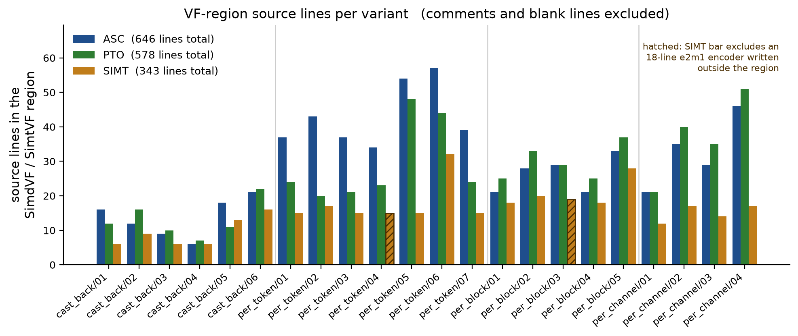
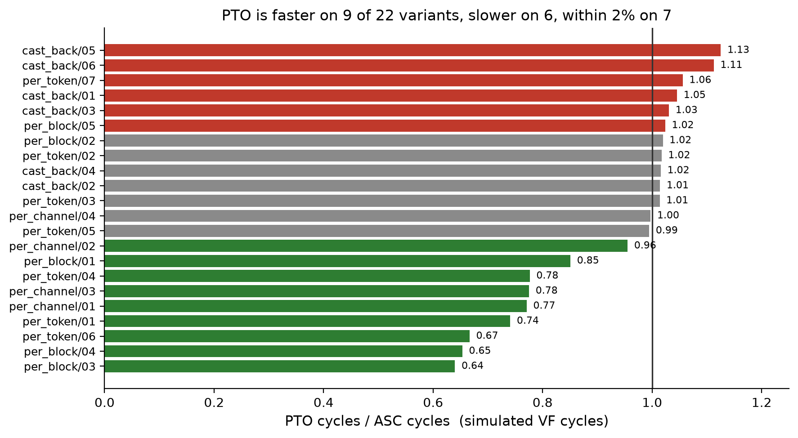

## Writing NPU quant kernels: SIMT vs PTO vs ASC

**Code size and simulated performance of three tilelang vector frontends
implementing one group-wise quantization algorithm.**

- 22 kernel variants, each implemented in ASC, PTO and SIMT plus a PyTorch
  reference: 88 kernels, all passing `python -m harness.check`
- msprof-simulated VF cycles for all 66 NPU kernels
- tilelang 0.1.15, ptoas vmi 0.1.9, CANN 9.2.0-beta.2, SoC `Ascend950PR_9599`
- Single core, `T.Kernel(1)`. Only the `T.SimdVF` / `T.SimtVF` region differs
  between the three implementations of a variant; tiling, DMA and buffer
  allocation are identical.

---

## tilelang frontend comparison

Group-wise quantization, in PyTorch:

```python
grouped = x.float().view(m, k // group_size, group_size)
amax = grouped.abs().amax(dim=-1).clamp(min=E4M3_CLAMP_MIN)
sf = amax / E4M3_MAX
q = (grouped * (E4M3_MAX / amax).unsqueeze(-1)).view(m, k).to(torch.float8_e4m3fn)
```

| frontend | abstraction level | smallest unit of data |
|---|---|---|
| **ASC** (`T.simd`, `S`) | named hardware instruction and distribution mode | one 64-lane vector register |
| **PTO/VMI** (`T.vmi`, `V`) | operation with width and segment count as arguments | one logical vector, any width |
| **SIMT** (`T.SimtVF`, `T.Parallel`) | per-element expression | one element, held by one thread |

`T.SimdVF` / `T.SimtVF` regions range from **6 to 57 lines** across the 22
variants. msprof-simulated VF cycles for the same variant differ by **10-100x
between the SIMT and the SIMD implementations**, and by up to 1.6x between the
two SIMD frontends.

---

## ASC vs PTO: fewer operations, comparable cycles

PTO expresses the same 22 kernels in **74% of ASC's vector operations** and
**89% of its source lines**. Simulated cycles do not follow:

| PTO relative to ASC | |
|---|---|
| vector operations written | 74% |
| `T.SimdVF` source lines | 89% |
| simulated VF cycles | **0.92x mean**, range 0.64x-1.13x |

- PTO uses fewer cycles on **9 of 22** variants, more on 6, and is
  within 2% on 7
- On 4 of those 9 it writes *more* operations than ASC
- Operations written and cycles executed correlate at **Pearson r = -0.09**
  (n = 22): across this set, source size carries no information about cycle count

Both SIMD frontends are 3-100x faster than SIMT on every variant.

---

## Benchmark setup (and caveats resolved)

**Cycle measurement.** Sum the `cycles` column of
`core0.veccore0_instr_exe.csv` over rows whose `instr` is a VF launch (`VF` for
SIMD, `VF_SIMT` for SIMT). The filter keys on `instr`, not `pipe`: every VF row
sits on pipe `PUSHQ`, which `MOVEMASK` and `PUSH_PB` also use.

**Correctness.** Each kernel is compared against `harness/oracle.py`, with an
assertion that the result was read back from the device. Cycles are not reported
for a kernel that computed a wrong result.

**Equal work.** VF launch counts were compared across the three frontends on
every variant. They agree except on `per_token/05`, where ASC and PTO issue 34
and SIMT 32; the two extra launches build the gather index SIMT does not need.

**Two measurement errors found and corrected.** `per_token/06` and
`per_block/05` allocate a placeholder input with `torch.zeros(device=...)`,
which is an aten fill *kernel*; msprof profiles the first operator, so all three
frontends had measured that fill. Detected because three different
implementations reported identical cycle counts. Both are now measured through
`tools/vf_drive.py`, and `tools/vf_trace_audit.py` checks the instruction log of
all 66 traces for the arithmetic a quant kernel must contain.

---

## Walkthrough: nine variants, four kinds of layout mismatch

The algorithm is the same in all 22 variants. What changes is where its
quantities sit relative to the 64- or 128-lane vector register.

| | variant | code pattern | what it decides |
|---|---|---|---|
| **A** reduce | `per_channel/01` | one channel per lane | nothing to simplify |
| | `per_token/01` | 4 groups per register | PTO's clearest win |
| | `per_block/01` | 32x32 tile to a scalar | counts mispredict cycles |
| **B** scale | `cast_back/01` | one scalar across lanes | SIMT's first real cut |
| | `per_token/02` | exponent, any width | PTO's width argument |
| | `cast_back/02` | nothing to factor out | PTO's operands cost lines |
| **C** output | `per_channel/02` | interleave two registers | SIMT drops an instruction |
| | `per_token/05` | transposed store = gather | biggest cut, and its price |
| **D** convert | `per_token/04` | float32 -> e2m1 | SIMT's 99.6x |

The other 13 variants compose these patterns and are measured in the tables at
the end. Long form: companion report, sections 2-8.

---

## A1 `per_channel/01`: the reduction axis is already the lane axis

One scale per channel, so the reduction runs down the token axis. A channel
occupies one lane from start to finish and no frontend performs a cross-lane
operation.

**ASC** accumulates into a register across 32 rows:

```python
acc = S.alloc_local((1,), T.float32)
# seeding with the clamp floor makes the clamp free
acc[0] = S.vdup(E4M3_CLAMP_MIN, T.float32)
for row in T.serial(group_tokens):
    v = S.vabs(S.vcvt(S.vld(x_ub[row, col], dist="UNPK_B16"),
                      T.float32))
    # lane c holds the max over tokens seen so far
    acc[0] = S.vmax(acc[0], v)
```

**PTO** — the same structure, with mask and width operands:

```python
acc = V.alloc_local((1,), V.vreg(LANES, T.float32))
# seeding with the clamp floor makes the clamp free
acc[0] = V.vbrc(T.float32(E4M3_CLAMP_MIN), size=LANES)
for row in T.serial(group_tokens):
    v = V.vabs(V.vcvt(V.vload(x_ub[row, col], size=LANES),
                      "float32"), mask)
    # lane c holds the max over tokens seen so far
    acc[0] = V.vmax(acc[0], v, mask)
```

---

## A1 `per_channel/01`: equal source, unequal cycles

**SIMT** assigns one thread per channel and loops over the 32 rows:

```python
for c in T.Parallel(hidden):
    amax = T.alloc_var(T.float32)
    amax = E4M3_CLAMP_MIN
    for row in T.serial(group_tokens):
        amax = T.max(amax,
                     T.abs(T.Cast("float32", x_ub[row, c])))
    sf_ub[c] = amax / E4M3_MAX
```

**Measured** — cycles ASC 502 / PTO 387 / SIMT 2,677 (0.77x / 5.33x vs ASC); VF-region lines 21 / 21 / 12.

ASC and PTO write 17 and
16 vector operations and
21 lines each: segment counts and width
arguments have nothing to apply to. The cycles still differ by
0.77x,
because ASC's vector type is 64 lanes and PTO's `size=LANES` is 128 — at
`hidden=128` ASC's column-tile loop runs twice and PTO's once.

> **A1** — where the data already lines up with the lanes, PTO has nothing to
> factor out and SIMT nothing to remove; SIMT states the same three stages in
> 12 lines at
> 5.33x
> the cycles. The cycle difference comes from register width, which no count of
> source lines can see. That recurs, larger, at A3.

---

## A2 `per_token/01`: a segmented reduction is PTO's clearest win

Each 32-channel group needs its own maximum. An ASC vector reduction produces
one value per register, so 4 groups require 4 masked reductions and 4
single-element stores:

```python
S.vsts(amax_ub[group], S.vcmax(a0, mask_low), dist="ONEPT_B32")
S.vsts(amax_ub[group + 1], S.vcmax(a0, mask_high),
       dist="ONEPT_B32")
S.vsts(amax_ub[group + 2], S.vcmax(a1, mask_low),
       dist="ONEPT_B32")
S.vsts(amax_ub[group + 3], S.vcmax(a1, mask_high),
       dist="ONEPT_B32")
```

**PTO** declares the segment count on one reduction:

```python
V.vstore(V.vcmax(V.vabs(x, mask), mask, group=groups_per_pair),
         amax_ub[group])
```

8 instructions become 3. The matching broadcast on the apply pass collapses from
4 loads plus 2 selects to 1 load.

---

## A2 `per_token/01`: SIMT, and the measured result

**SIMT** assigns one thread per group:

```python
for g in T.Parallel(num_groups):
    amax_l[g] = E4M3_CLAMP_MIN
    for j in T.serial(group_size):
        v = T.Cast("float32", x_ub[g * group_size + j])
        amax_l[g] = T.max(amax_l[g], T.abs(v))
    inv_l[g] = E4M3_MAX / amax_l[g]
    sf_l[g] = amax_l[g] / E4M3_MAX
```

**Measured** — cycles ASC 6,176 / PTO 4,576 / SIMT 71,606 (0.74x / 11.59x vs ASC); VF-region lines 37 / 24 / 15.

`T.Parallel(num_groups)` has extent 4 at `K=128, group_size=32`, so the SIMT
reduction uses 4 of the 128 declared threads.

> **A2** — the one pattern where PTO is both shorter and faster:
> 19 operations against ASC's
> 39 at
> 0.74x the
> cycles. Operation count and cycle count favour PTO together on
> 6 of the 22 variants. SIMT is shorter again
> (15 lines) at
> 11.59x.

---

## A3 `per_block`: the same tile, half as many steps

One scalar per 32x32 tile. **ASC** takes 16 steps of 64 lanes:

```python
for chunk in T.serial(num_chunks):
    v = S.vabs(S.vcvt(S.vld(flat_x[chunk * LANES],
                            dist="UNPK_B16"), T.float32))
    S.vsts(run_ub[chunk], S.vcmax(v, mask_all),
           dist="ONEPT_B32")
```

**PTO** reaches 128 float32 lanes, so the tile takes 8 steps of 128:

```python
for chunk in T.serial(num_chunks):
    v = V.vabs(V.vcvt(V.vload(flat_x[chunk * LANES],
                              size=LANES), "float32"), mask)
    V.vstore(V.vcmax(v, mask, group=1), run_ub[chunk])
```

| `per_block` | `/01` | `/02` | `/03` | `/04` | `/05` |
|---|---:|---:|---:|---:|---:|
| operations, ASC -> PTO | 21->22 | 27->30 | 28->26 | 21->22 | 29->31 |
| cycles, PTO/ASC | **0.85x** | 1.02x | **0.64x** | **0.65x** | 1.02x |

> **A3** — more operations per step, half as many steps: a static count
> cannot observe a trip count.

---

## B1 `cast_back/01`: broadcasting one scalar across a lane range

64 consecutive channels span two scale groups, so each lane requires one of two
scalars.

**ASC** builds the scale vector: two broadcast loads and a lane-mask select.

```python
lo = S.vld(sf_ub[group], dist="BRC_B32")
hi = S.vld(sf_ub[group + 1], dist="BRC_B32")
scale = S.vsel(lo, hi, mask_low)
```

**PTO** declares the segment structure on the load:

```python
scale = V.vload(sf_ub[group], size=LANES, stride=1,
                dist_mode="brc", group=groups_per_strip)
```

**SIMT** indexes the scale array per element.

```python
for i in T.Parallel(hidden):
    o_l[i] = q_l[i] * sf_ub[i // group_size]
```

---

## B1 `cast_back/01`: measured, and output dtype selection

**Measured** — cycles ASC 2,105 / PTO 2,201 / SIMT 6,908 (1.05x / 3.28x vs ASC); VF-region lines 16 / 12 / 6.

The variant also switches output dtype. ASC selects a different store
instruction — the wider dtype takes the simpler one:

```python
if out_dtype == "bfloat16":
    S.vsts(out_ub[col], S.vcvt(scaled, T.bfloat16),
           dist="PK_B32")      # 64 lanes -> 64 x 2 bytes
else:
    S.vsts(out_ub[col], scaled,
           dist="NORM_B32")    # 64 lanes -> 64 x 4 bytes
```

PTO infers packing from the destination buffer, so only the convert changes:

```python
if out_dtype == "bfloat16":
    V.vstore(V.vcvt(scaled, "bfloat16"), out_ub[col])
else:
    V.vstore(scaled, out_ub[col])
```

SIMT emits no dtype branch: `T.copy` converts between buffers.

> **B1** — the first variant where SIMT's source is materially shorter
> (16 lines to
> 6): per-element indexing replaces explicit
> lane-mask construction, at
> 3.28x —
> the 2nd lowest SIMT ratio of 22.

---

## B2 `per_token/02`: lane count as a parameter

The scale is rounded up to a power of two by rewriting the float32 exponent
field. **ASC** fixes the lane count in every type name (`"uint32x64"`):

```python
one = S.vdup(1, T.uint32)
bits = T.reinterpret(S.vmuls(clamped, inv_qmax), "uint32x64")
# ((bits - 1) >> 23) + 1  ==  ceil(log2(v)) + 127
biased = S.vadds(S.vshrs(S.vsub(bits, one), 23), 1)
sf = T.reinterpret(S.vshls(biased, 23), "float32x64")
# 254 - biased == 127 - ceil_exp: the negated exponent
inv = T.reinterpret(
    S.vshls(S.vsub(S.vdup(254, T.uint32), biased), 23),
    "float32x64")
```

**PTO** takes the width as an argument, so one definition serves 4, 64, 128 or
256 lanes:

```python
one = V.vbrc(T.uint32(1), size=lanes)
shift = V.vbrc(T.uint32(23), size=lanes)
bits = V.vinterpret_cast(
    V.vmul(clamped, V.vbrc(T.float32(inv_qmax), size=lanes), mask), "uint32")
# ((bits - 1) >> 23) + 1  ==  ceil(log2(v)) + 127
biased = V.vadd(V.vshr(V.vsub(bits, one), shift), one)
sf = V.vinterpret_cast(V.vshl(biased, shift), "float32")
```

---

## B2 `per_token/02`: the same arithmetic on scalars

**SIMT** has no vector width to carry:

```python
bits = T.reinterpret("int32", amax / E4M3_MAX)
biased = ((bits - 1) >> 23) + 1
sf_l[g] = T.reinterpret("float32", biased << 23)
inv_l[g] = T.reinterpret("float32", (254 - biased) << 23)
```

**Measured** — cycles ASC 4,608 / PTO 4,688 / SIMT 71,008 (1.02x / 15.41x vs ASC); VF-region lines 43 / 20 / 17.

> **B2** — 45 operations against
> 14 is the largest operation-count reduction in
> the set, at a
> 1.02x cycle
> ratio. PTO's gain here is a definition that is written once instead of per
> width; it is not a speed gain, and reporting only the operation count would
> have presented it as one.

---

## B3 `cast_back/02`: where PTO's explicitness costs source length

Decoding a UE8M0 exponent byte. **ASC** names the distribution mode on the load:

```python
packed = S.vld(sf_ub[strip], dist="BRC_B16")
bits = S.vand(S.vshl(T.reinterpret(packed, "uint32x64"),
                     sf_shift), exp_mask)
# An exponent field with a zero mantissa *is* 2^(e-127).
```

**PTO** states width, stride, group count and mask:

```python
packed = V.vload(sf_ub[strip], size=LANES * 2, stride=1,
                 dist_mode="brc", group=1)
bits = V.vand(V.vshl(V.vinterpret_cast(packed, "uint32"),
                     sf_shift), exp_mask)
scale = V.vinterpret_cast(bits, "float32")
```

Two further ASC advantages, both outside this snippet:

- **No per-lane variable right shift in VMI.** `S.vshr(v, shifts)` accepts a
  shift vector; `V.vshrs` accepts a scalar only, so production PTO computes both
  byte positions and selects.
- **`per_channel/04`** is PTO's longest region, 51
  lines against 46, at a 1.00x cycle ratio.

> **B3** — the counter-example to B2: with nothing to factor out, operation
> counts tie at 12 and PTO is
> 4
> lines longer than ASC (16 vs
> 12). The mandatory `size=` and mask
> operands are a real ergonomic cost of VMI.

---

## C1 `per_channel/02`: M-packed scales require a lane interleave

Output byte `2c` holds m-group `2i`'s exponent for channel `c`, byte `2c+1`
holds m-group `2i+1`'s. On a vector unit this is an interleave instruction.

**ASC:**

```python
a = S.vld(sf_rows_ub[0, col], dist="NORM_B8")
b = S.vld(sf_rows_ub[1, col], dist="NORM_B8")
# A uint8 register is 256 lanes, so `lo` already holds the
# interleave of the first 128 elements of each input --
# exactly the 256 output bytes for these 128 channels.
# `hi` interleaves the padding and is discarded.
lo, _ = S.vintlv(a, b)
S.vsts(packed_ub[col * PACK_FACTOR], lo, dist="NORM_B8")
```

**PTO** — same instruction, with the vector width given explicitly:

```python
a = V.vload(sf_rows_ub[0, col], size=BYTE_LANES * 2)
b = V.vload(sf_rows_ub[1, col], size=BYTE_LANES * 2)
# A uint8 register is 256 lanes, so `lo` already holds the
# interleave of the first 128 elements of each input --
# exactly the 256 output bytes for these 128 channels.
# `hi` interleaves the padding and is discarded.
lo, _ = V.vintlv(a, b, byte_mask)
V.vstore(lo, packed_ub[col * PACK_FACTOR])
```

---

## C1 `per_channel/02`: SIMT replaces the interleave with two scalar stores

```python
for c in T.Parallel(hidden):
    packed_ub[PACK_FACTOR * c] = sf_rows_ub[0, c]
    packed_ub[PACK_FACTOR * c + 1] = sf_rows_ub[1, c]
```

A `uint8` vector register holds 256 lanes, so the loads above read 128 bytes
past the 128 meaningful ones. Both SIMD frontends therefore pad the scratch
buffer by a whole tile:

```python
sf_rows_ub = T.alloc_shared((PACK_FACTOR, hidden + BYTE_LANES), T.uint8)
```

```python
sf_rows_ub = T.alloc_shared((PACK_FACTOR, hidden + BYTE_LANES), T.uint8)
```

A scalar store cannot overrun, so SIMT allocates the exact size:

```python
sf_rows_ub = T.alloc_shared((PACK_FACTOR, hidden), T.uint8)
```

---

## C1 `per_channel/02`: the measured cost of removing the interleave

| | ASC | PTO | SIMT |
|---|---:|---:|---:|
| VF-region lines | 35 | 40 | **17** |
| simulated cycles | 849 | 811 | 5,964 |
| vs ASC | 1.00x | 0.96x | 7.02x |

- SIMT removes one instruction and one padding requirement, using 17 lines
  against ASC's 35, at **7.02x** the cycles
- PTO is **5 lines longer** than ASC (40 vs 35) at 0.96x the cycles: the
  explicit `size=` and mask operands cost source length, not time

> **C1** — SIMT's largest structural simplification so far: it deletes an
> instruction *and* a correctness rule about register width. Both deletions are
> real; 7.02x is what they cost.

---

## C2 `per_token/05`: column-major scales require a register gather

Lane assignment inside a vector register is fixed, so transposing the scale
array means computing, per lane, which source element that lane receives.

**ASC** builds the index vector from the lane id:

```python
lane = S.vci(0, T.int32)
token_of_lane = S.vand(T.reinterpret(lane, "uint32x64"),
                       S.vdup(token_block - 1, T.uint32))
group_of_lane = T.reinterpret(S.vshrs(lane, log2_block), "uint32x64")
S.vsts(idx_ub[0],
       S.vadd(S.vmuls(token_of_lane, SF_STRIDE), group_of_lane),
       dist="NORM_B32")
```

...and gathers through it:

```python
S.vsts(sf_out_ub[base, 0],
       S.vgather2(sf_dense_ub[0, base], idx), dist="NORM_B32")
```

---

## C2 `per_token/05`: PTO needs an extra broadcast; SIMT needs an index

**PTO** performs the same index arithmetic. VMI has no scalar-operand `vmul`, so
the stride constant is first broadcast into a vector — 3 lines where ASC uses 2:

```python
stride_v = V.vbrc(T.uint32(SF_STRIDE), size=LANES)
V.vstore(V.vadd(V.vmul(token_of_lane, stride_v, mask64),
                group_of_lane), idx_ub[0])
```

**SIMT** stores the scale at the transposed index. No index vector, no gather:

```python
sf_out_ub[g, sub] = T.reinterpret("float32", biased << 23)
```

---

## C2 `per_token/05`: the sharpest source-size / cycle trade in the set

| | ASC | PTO | SIMT |
|---|---:|---:|---:|
| VF-region lines | 54 | 48 | **15** |
| simulated cycles | 5,477 | 5,448 | 75,281 |
| vs ASC | 1.00x | 0.99x | 13.74x |

- 15 SIMT lines against ASC's 54 is the largest source-size reduction among the
  22 variants
- SIMT costs **13.74x** the cycles, the 14th lowest SIMT ratio of 22
- ASC and PTO are within 1% of each other: a gather is a single hardware
  operation, so VMI has no segment structure or width to collapse here

> **C2** — one line of SIMT replaces nine of index arithmetic, and the SIMD
> frontends tie because the hardware already provides the operation. Where the
> work *is* index arithmetic, SIMT is the shortest by a wide margin and the
> slowest by one too.

---

## D1 `per_token/04`: FP4 output, where SIMT has no instruction

ASC and PTO both reach a hardware `float32 -> e2m1` convert. Their work is
limited to pre-rounding to bfloat16 with a sticky bit.

**ASC** pairs two registers to deinterleave them, then converts:

```python
low, high = S.vdintlv(T.reinterpret(q0, "uint16x128"),
                      T.reinterpret(q1, "uint16x128"))
odd = S.vor(high, S.vmin(low, one_u16))
S.vsts(q_ub[col],
       S.vcvt(T.reinterpret(odd, "bfloat16x128"),
```

**PTO** uses `V.vunzip`, which splits one value instead of pairing two:

```python
low, high = V.vunzip(x, "uint16")
one = V.vbrc(T.uint16(1), size=lanes)
return V.vinterpret_cast(V.vor(high, V.vmin(low, one)), "bfloat16")
```

---

## D1 `per_token/04`: SIMT encodes e2m1 in software

No FP4 store is reachable from a `T.SimtVF` region. The SIMT kernel declares its
output `uint8` and extracts the float32 fields by hand — the first 6 lines of an
18-line encoder covering sign, exponent, subnormal renormalization,
guard/round/sticky and saturation:

```python
bits = T.reinterpret("int32", v)
# bit 3 of (bits >> 28) is bit 31 of bits: the sign nibble, without
# depending on whether >> sign-extends.
sign_nib = (bits >> 28) & 0x8
exps = (bits >> 23) & 0xFF
mant = bits & 0x7FFFFF
```

| | ASC | PTO | SIMT |
|---|---:|---:|---:|
| VF-region lines | 34 | 23 | **15** |
| simulated cycles | 6,160 | 4,784 | 613,632 |
| vs ASC | 1.00x | 0.78x | 99.62x |

The result is bit-exact against the PyTorch reference packer. `per_block/03`
carries the same encoder at 16.77x.

---

## D1 `per_token/04`: 99.6x decomposes into instructions and divergence

| factor | SIMT `per_token/04` | other SIMT `per_token` variants |
|---|---|---|
| instructions issued | 124,294 | ~37,000 |
| cycles per instruction | 4.94 | 1.90-2.01 |

The second factor is branch divergence. `T.if_then_else` on a data-dependent
per-element condition lowers to a branch rather than a predicated select, and
this is the only variant whose trace carries a large number of
`SIMT_START_DVG` markers.

Rewriting the encoder's three conditionals as mask arithmetic
(`m = -T.Cast("int32", cond)`, then `(a & m) | (b & ~m)`) issues **45% more
instructions** and runs at **0.56x the cycles** —
345,189 against 613,632, or
**56.0x ASC instead of 99.6x**. Both spellings are in
the kernel behind a `branch_free` flag and the harness asserts their outputs are
byte-identical.

> **D1** — a missing instruction is not a style difference. Of the
> 99.6x, a factor of 1.78x is a code-generation
> gap a GPU compiler would not have, since it predicates such a conditional into
> a select; the remaining 56.0x is a software encoder standing in
> for one convert instruction.

---

## Source size: VF-region lines, all three frontends



Totals **646 / 578 / 343** lines — PTO 89% of ASC,
SIMT 53%. PTO is *longer* than ASC on 11 of the 22: its
saving is concentrated in the segmented-reduction variants (A2) and spent again
on `size=` and mask operands elsewhere (B3). SIMT is shorter on
21 of 22 and ties on the other.

---

## PTO vs ASC: simulated cycles per variant



---

## SIMT vs ASC: simulated cycles per variant


`per_token/04` is separated because its cost is a missing hardware instruction
(previous section), not a property of the thread model. The remaining 21
variants span 3.20x-21.18x.

---

## Measured data (1/2): `cast_back`, `per_token`

| variant | ops A/P | lines A/P/S | cyc A | cyc P | cyc S | P/A | S/A |
|---|---|---|---:|---:|---:|---:|---:|
| `cast_back/01` | 9/7 | 16/12/6 | 2,105 | 2,201 | 6,908 | 1.05 | 3.28 |
| `cast_back/02` | 12/12 | 12/16/9 | 2,201 | 2,233 | 7,033 | 1.01 | 3.20 |
| `cast_back/03` | 8/6 | 9/10/6 | 2,080 | 2,144 | 6,969 | 1.03 | 3.35 |
| `cast_back/04` | 6/6 | 6/7/6 | 2,016 | 2,048 | 6,983 | 1.02 | 3.46 |
| `cast_back/05` | 16/8 | 18/11/13 | 2,296 | 2,584 | 10,152 | 1.13 | 4.42 |
| `cast_back/06` | 14/14 | 21/22/16 | 2,272 | 2,528 | 9,275 | 1.11 | 4.08 |
| `per_token/01` | 39/19 | 37/24/15 | 6,176 | 4,576 | 71,606 | 0.74 | 11.59 |
| `per_token/02` | 45/14 | 43/20/17 | 4,608 | 4,688 | 71,008 | 1.02 | 15.41 |
| `per_token/03` | 44/15 | 37/21/15 | 4,608 | 4,672 | 74,136 | 1.01 | 16.09 |
| `per_token/04` | 37/17 | 34/23/15 | 6,160 | 4,784 | 613,632 | 0.78 | 99.62 |
| `per_token/05` | 56/38 | 54/48/15 | 5,477 | 5,448 | 75,281 | 0.99 | 13.74 |
| `per_token/06` | 39/30 | 57/44/32 | 6,864 | 4,576 | 71,606 | 0.67 | 10.43 |
| `per_token/07` | 31/17 | 39/24/15 | 4,864 | 5,136 | 72,490 | 1.06 | 14.90 |

`/06` `full` emits `/01`'s kernel, hence the identical SIMT cycle count.

---

## Measured data (2/2): `per_block`, `per_channel`

| variant | ops A/P | lines A/P/S | cyc A | cyc P | cyc S | P/A | S/A |
|---|---|---|---:|---:|---:|---:|---:|
| `per_block/01` | 21/22 | 21/25/18 | 1,086 | 924 | 19,276 | 0.85 | 17.75 |
| `per_block/02` | 27/30 | 28/33/20 | 918 | 936 | 19,444 | 1.02 | 21.18 |
| `per_block/03` | 28/26 | 29/29/19 | 1,625 | 1,040 | 27,256 | 0.64 | 16.77 |
| `per_block/04` | 21/22 | 21/25/18 | 1,414 | 924 | 19,272 | 0.65 | 13.63 |
| `per_block/05` | 29/31 | 33/37/28 | 918 | 940 | 19,444 | 1.02 | 21.18 |
| `per_channel/01` | 17/16 | 21/21/12 | 502 | 387 | 2,677 | 0.77 | 5.33 |
| `per_channel/02` | 28/29 | 35/40/17 | 849 | 811 | 5,964 | 0.96 | 7.02 |
| `per_channel/03` | 23/19 | 29/35/14 | 930 | 721 | 4,073 | 0.78 | 4.38 |
| `per_channel/04` | 32/33 | 46/51/17 | 738 | 736 | 5,964 | 1.00 | 8.08 |

`per_block` reduces a 32x32 tile to one scalar; `per_channel` reduces along the
token axis. `per_block/02` and `/05`, and `per_channel/02` and `/04`, share SIMT
cycle counts for the same reason: the composed variant emits the earlier
variant's `T.SimtVF` region unchanged.

---

## Totals across the 22 variants

| | PTO vs ASC | SIMT vs ASC |
|---|---|---|
| vector operations | 74% | not comparable |
| source lines | 89% | **53%** |
| simulated cycles | **0.92x** (0.64x-1.13x) | 10.44x (3.20x-21.18x) |

SIMT has no comparable operation count: its arithmetic is plain operators, so
the backend selects the instructions.

- PTO uses fewer cycles on 9 of 22 variants, more on 6, within 2% on 7
- The SIMT range excludes `per_token/04`; including it the maximum is 99.62x
- SIMT costs under 6x on 8 of 22 variants and over 10x on 11

---

## Caveats

1. **Simulated cycles, not hardware.** `msprof op simulator`, SoC
   `Ascend950PR_9599`. No silicon measurement is claimed.
2. **One shape per variant**, mostly `M=32, K=128`. Ratios compare three
   implementations of one variant and are valid; absolute cycle counts are not
   comparable between variants.
3. **Single core.** No multi-core scheduling, double buffering or cache hints.
4. **The SIMT kernels are not tuned.** They use the first formulation a
   thread-model implementation suggests. A separate SIMT-vs-SIMD suite sweeping
   several strategies per kernel measured 0.33x-53x, including SIMT faster on
   some grouped reductions.
5. **Line counts exclude helpers defined outside the VF region**, in all
   frontends. This understates SIMT by 18 lines on each of the two FP4 variants.

---

## Caveat 6: the declared SIMT thread count

Every SIMT kernel declares `T.SimtVF(threads=128)`. At `K=128, group_size=32`
the two passes inside the region have different extents:

```text
for g in T.Parallel(num_groups):     extent 4    (the reduction)
for i in T.Parallel(hidden):         extent 128  (the apply)
```

Measured on `per_token/01`, the same kernel built at three declared widths
(`harness/probe/simt_thread_count.py`, all three verified against the oracle):

| `threads` | simulated cycles | vs 128 | correct |
|---:|---:|---:|---|
| 32 | 71,278 | 1.00x | yes |
| 64 | 69,047 | 0.96x | yes |
| 128 | 71,606 | 1.00x | yes |

**Lowering the declared thread count does not recover the cost.** Across a 4x
range the spread is under 4%, so the penalty is not caused by declaring more
threads than the reduction uses. It is the per-element execution model: ~37,000
instructions at 1.95 cycles each, against 32 VF launches of vector work.

---

## Conclusions

**SIMT reduces source size where the SIMD frontends move data between lanes.**
The three cases measured here are a group broadcast (B1, 16 lines to 6), a lane
interleave (C1, 35 to 17) and a register gather (C2, 54 to 15). In each, the SIMD code is dominated by index
arithmetic that the thread model does not require, and in `per_channel/02` SIMT
also removes the 256-lane padding requirement. The cost is 3.28x, 7.02x and
13.74x simulated cycles respectively.

**PTO simplifies where a segment count or a width replaces repetition** (A2,
B2: 39 operations to 19 and 45 to 14) **and costs source length where there is
nothing to factor out** (B3: 4 lines longer at an identical operation count).

**Neither SIMD frontend has anything to simplify where the operation already maps onto
the hardware.** When a channel occupies one lane (A1) or the value being placed
is a scalar (`per_block/01`), ASC and PTO use 17 and 16 operations
and 21 lines each, and SIMT's shorter source expresses the same three stages.

**Where the hardware has an instruction, the frontend that can name it wins by a
wide margin.** FP4 output (D1) costs SIMT 99.6x. A factor of
1.78x of that is a code-generation gap — branch divergence the
mask-arithmetic spelling removes — and the remaining 56.0x is a
software encoder standing in for one convert instruction.

---

## Frontend selection

| | applicable when |
|---|---|
| **SIMT** | development speed outweighs cycles; or the kernel is dominated by data placement — packing, transposes, gathers — where SIMT is 2-4x shorter and removes lane-indexing errors |
| **PTO/VMI** | general production vector code: 74% of ASC's operations at 0.92x of its cycles, with width-parameterised definitions ASC cannot express |
| **ASC** | an instruction VMI does not expose is required (per-lane variable right shift), or a specific distribution mode is the objective |

**On methodology.** Source size correlates with simulated cycles at r = -0.09
on this set: a frontend comparison reporting only source size reports one of the
two quantities that matter.

